<!-- Animated typing subtitle -->

 

<!-- Unified dark-palette navbar badges -->

  

  

  

<!-- TECH STACK -->

  
  <h3>Cloud, DevOps &amp; Applied AI Stack</h3>

<table>
<tr>
<td align="center" width="100%">

<b>☁️ Cloud, DevOps &amp; Infrastructure</b>

</td>
</tr>
<tr>
<td align="center" width="100%">

<b>⚙️ Backend, Data &amp; Search</b>

</td>
</tr>
<tr>
<td align="center" width="100%">

<b>🤖 Applied AI &amp; Agentic LLM Orchestration</b>

  
  
  
  
  
  
  
  

</td>
</tr>
</table>

  

<!-- FEATURED PROJECTS -->

  
  <h3>Engineered Systems &amp; Production Architectures</h3>
  
Production platforms, AI orchestration pipelines, and cloud infrastructure spanning private and public systems.

 

### 🔒 Enterprise &amp; Private Systems

<table>
<tr>
<td width="50%" valign="top">

### 🧠 AI HirePro Enterprise
*Recruitment Automation &amp; Agentic LLM Orchestration*

End-to-end recruitment pipeline orchestrating 6 stateful LangGraph agents for JD parsing, semantic scoring, and AI interviews. Features OnboardGuard verification across government identity documents with zero manual review.

 

<kbd>LangGraph</kbd> <kbd>FastAPI</kbd> <kbd>Groq Llama-3</kbd> <kbd>ChromaDB</kbd> <kbd>Docker</kbd> <kbd>LangSmith</kbd>

</td>
<td width="50%" valign="top">

### 🎯 NexAssess
*Self-Hosted Technical Assessment &amp; Proctoring Platform*

Production online assessment platform with AI proctoring, real-time risk scoring, and role-based access control. Validated by 507 automated tests with automated CI/CD deployment on Vercel backed by PostgreSQL.

 

<kbd>Next.js 15</kbd> <kbd>TypeScript</kbd> <kbd>Prisma</kbd> <kbd>PostgreSQL</kbd> <kbd>Supabase</kbd> <kbd>PWA</kbd>

</td>
</tr>
<tr>
<td width="50%" valign="top">

### 🏗️ Three-Tier EKS IaC
*Cloud Infrastructure as Code on AWS*

Production Terraform modules provisioning VPC, EKS cluster, managed node groups, and Helm microservices. Features dual-layer auto-scaling via Cluster Autoscaler and Horizontal Pod Autoscaler with AWS ALB Ingress.

 

<kbd>Terraform</kbd> <kbd>AWS EKS</kbd> <kbd>Kubernetes</kbd> <kbd>Helm</kbd> <kbd>Docker</kbd> <kbd>ECR</kbd>

</td>
<td width="50%" valign="top">

### 📊 SRE Monitoring Stack
*Declarative Observability &amp; Alerting Pipeline*

Declarative observability stack automating Prometheus scraping and custom threshold alerting for cluster anomalies. Alertmanager inhibition rules prevent cascading storms, synchronized continuously via Jenkins CI/CD.

 

<kbd>Prometheus</kbd> <kbd>Alertmanager</kbd> <kbd>Grafana</kbd> <kbd>Jenkins</kbd> <kbd>Linux</kbd> <kbd>YAML</kbd>

</td>
</tr>
</table>

 

### 🌐 Open-Source &amp; Public Systems

<table>
<tr>
<td width="33%" valign="top">

### 🤖 [Pipeline Debugger](https://github.com/bhatadarsh/Automated-Pipeline-Debugger)
*AI-Powered DevOps Automation*

Autonomous Airflow incident resolver using Celery workers to capture task failures, OpenAI to diagnose tracebacks, and Slack SDK to push structured root-cause fixes.

 

<kbd>Python</kbd> <kbd>FastAPI</kbd> <kbd>Celery</kbd> <kbd>Redis</kbd> <kbd>OpenAI</kbd> <kbd>Airflow</kbd>

</td>
<td width="33%" valign="top">

### 💬 [NL2SQL Analyst](https://github.com/bhatadarsh/NL2SQL-Task)
*Natural Language BigQuery Analytics*

Translates conversational queries into BigQuery SQL with safety validation guardrails, automated data visualizations, and AI narratives in Streamlit.

 

<kbd>Python</kbd> <kbd>Gemini API</kbd> <kbd>BigQuery</kbd> <kbd>Streamlit</kbd> <kbd>Pandas</kbd>

</td>
<td width="33%" valign="top">

### 📈 [Rank Tracker](https://github.com/bhatadarsh/keyword-rank-tracker)
*Full-Stack SERP Intelligence*

Automated Google SERP rank tracking platform across localized geographic regions, languages, and device profiles with dual-mode SQLite and PostgreSQL support.

 

<kbd>TypeScript</kbd> <kbd>FastAPI</kbd> <kbd>React 18</kbd> <kbd>PostgreSQL</kbd> <kbd>GitHub Actions</kbd>

</td>
</tr>
<tr>
<td width="33%" valign="top">

### 🔍 [ELK Monitoring](https://github.com/bhatadarsh/elk-nginx-monitoring)
*Production Log Observability*

Containerized log observability pipeline shipping Nginx access and error streams via Filebeat into Elasticsearch indices for real-time visualization in Kibana.

 

<kbd>Docker Compose</kbd> <kbd>Elasticsearch</kbd> <kbd>Kibana</kbd> <kbd>Filebeat</kbd> <kbd>Nginx</kbd>

</td>
<td width="33%" valign="top">

### 🚗 [Licence Detection](https://github.com/bhatadarsh/Vehicle-licence-detection)
*Computer Vision &amp; OpenCV*

Real-time license plate detection pipeline utilizing OpenCV Haar Cascade classifiers with comprehensive engineering trade-off benchmarks against YOLO and HOG+SVM.

 

<kbd>Python</kbd> <kbd>OpenCV</kbd> <kbd>Haar Cascade</kbd> <kbd>Computer Vision</kbd>

</td>
<td width="33%" valign="top">

### 🎬 [FactFuse](https://github.com/bhatadarsh/FactFuse-A-Youtube-Transcript-Summarizer)
*NLP Video Content Analysis*

Video analysis engine extracting YouTube transcripts via API, executing NLP summarization, and calculating factual-confidence scores based on claim verification metrics.

 

<kbd>Python</kbd> <kbd>Flask</kbd> <kbd>NLP</kbd> <kbd>Transcript API</kbd>

</td>
</tr>
</table>

---

<b>🔍 Recruiter Deep Dive — Private Project Architectures</b>

 

### AI HirePro Enterprise — LangGraph Stateful Pipeline

- **Problem:** Manual hiring is slow, siloed across stages, and unscalable during high-volume recruitment.
- **Workflow:** 6 LangGraph nodes execute JD parsing, semantic resume scoring via sentence-transformers, gap analysis, dynamic focus area selection, Groq Llama-3 interview orchestration, and OnboardGuard document verification.
- **Polyglot Storage:** PostgreSQL for candidate schemas, ChromaDB for semantic embeddings, MongoDB for raw extracted documents, and SQLite for lightweight session state.
- **Observability:** Granular distributed tracing across all agents instrumented with LangSmith.

---

### NexAssess — Assessment Platform

- **Architecture:** Next.js 15 App Router + Prisma ORM connected to Supabase PostgreSQL, deployed to Vercel edge.
- **AI Proctoring:** Real-time WebRTC streams with event-driven risk evaluation, capturing blur events, tab switching, and multiple face detections into an immutable audit trail.
- **Reliability:** 507 automated unit, integration, and Playwright end-to-end tests gating every deployment in GitHub Actions.

---

### Three-Tier EKS — Infrastructure as Code

- **Terraform Modules:** Declarative VPC provisioning (isolated private/public subnets), EKS managed control plane, and autoscaling worker node groups with least-privilege IAM roles.
- **Kubernetes &amp; Helm:** Declarative application deployment with Ingress routed via AWS Load Balancer Controller and horizontal autoscaling (HPA) coupled with Cluster Autoscaler.

---

### SRE Monitoring Stack — Alerting as Code

- **Observability:** Prometheus metric scrapers targeting `node_exporter` and custom service endpoints with unified `alert.rules.yml`.
- **Alert Routing:** Alertmanager groups alerts by severity and namespace, with inhibition rules preventing cascading alarm floods during core service interruptions.

  

<!-- GITHUB ACTIVITY & 3D CALENDAR -->

  
  <h3>GitHub Activity &amp; Contribution Metrics</h3>

 

&nbsp;

&nbsp;

&nbsp;

  

  
  <h3>Isometric Contribution Calendar</h3>

<a href="https://github.com/bhatadarsh/bhatadarsh/actions/workflows/profile-3d-contrib.yml">
  <picture>
    <source media="(prefers-color-scheme: dark)" srcset="https://raw.githubusercontent.com/bhatadarsh/bhatadarsh/output/profile-3d-contrib/profile-night-rainbow.svg">
    <source media="(prefers-color-scheme: light)" srcset="https://raw.githubusercontent.com/bhatadarsh/bhatadarsh/output/profile-3d-contrib/profile-green-animate.svg">
    
  </picture>
</a>

<!-- Snake animation (auto-generated by GitHub Actions) -->

  

**📬 Open to DevOps · Cloud · AI Engineering roles**

&nbsp;

 

*"Ship infrastructure like code. Debug systems like a scientist. Automate like it's the last thing you'll ever do."*

 

