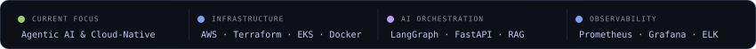
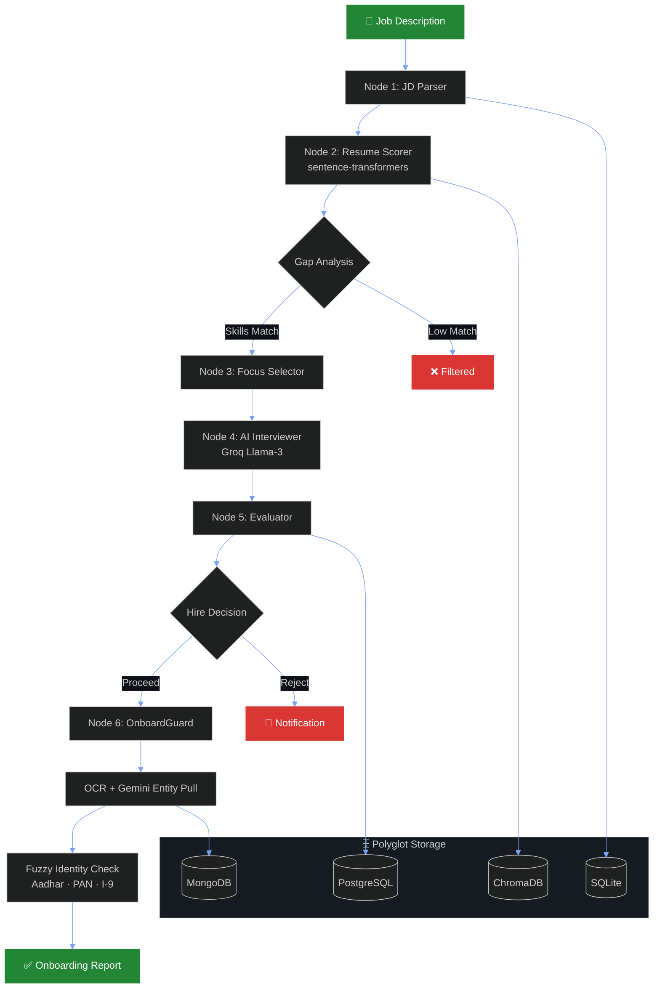
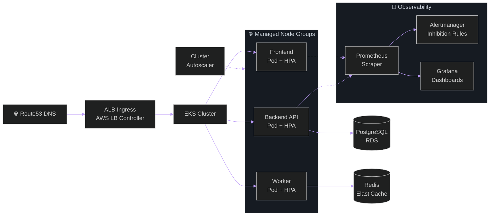

<!-- Animated typing subtitle -->

 

<!-- Unified dark-palette navbar badges -->

<!-- ═══════════════════════════════════════ -->
<!-- TERMINAL PROFILE -->
<!-- ═══════════════════════════════════════ -->

  

<!-- ═══════════════════════════════════════ -->
<!-- SYSTEM ARCHITECTURE MATRIX -->
<!-- ═══════════════════════════════════════ -->

  
  <h3>Production-Grade Engineering Stack</h3>

<table>
<tr>
<td align="center" width="50%">

 

**☁️ Cloud, Infrastructure &amp; Container Orchestration**

 

 

*Declarative IaC, multi-cluster K8s &amp; zero-downtime delivery*

 

</td>
<td align="center" width="50%">

 

**🔍 SRE, Observability &amp; CI/CD**

  

*Alert-as-code pipelines, log aggregation &amp; anomaly detection*

 

</td>
</tr>
<tr>
<td align="center" width="50%">

 

**🤖 Agentic AI &amp; LLM Orchestration**

 

*Stateful multi-agent pipelines, RAG &amp; semantic search*

 

</td>
<td align="center" width="50%">

 

**⚙️ Backend, Data &amp; High-Concurrency Systems**

 

 

*Async event-driven APIs, polyglot storage &amp; task queues*

 

</td>
</tr>
</table>

<!-- ═══════════════════════════════════════ -->
<!-- TELEMETRY STRIP -->
<!-- ═══════════════════════════════════════ -->

<!-- ═══════════════════════════════════════ -->
<!-- FEATURED PROJECTS -->
<!-- ═══════════════════════════════════════ -->

  
  <h3>Production Architectures &amp; Platforms</h3>

 

### 🔒 Enterprise &amp; Private Systems

<table>
<tr>
<td width="50%" valign="top">

  

### 🧠 AI HirePro Enterprise

*Recruitment Automation &amp; Agentic LLM Orchestration*

  
  
  

End-to-end recruitment pipeline orchestrating 6 stateful LangGraph agents — JD parsing, semantic scoring, gap analysis, AI interviews via Groq Llama-3, and OnboardGuard identity verification across Aadhar/PAN/I-9 documents.

  
  
  
  
  
  

</td>
<td width="50%" valign="top">

  
  

### 🎯 NexAssess

*Self-Hosted AI Assessment &amp; Proctoring Platform*

  
  
  

Production HackerRank/Mettl alternative with AI proctoring — real-time webcam risk scoring, RBAC (Admin/Recruiter/Candidate), and zero per-candidate cost. 507 Jest + Playwright tests gate every CI deployment.

  
  
  
  
  
  

</td>
</tr>
<tr>
<td width="50%" valign="top">

  

### 🏗️ Three-Tier EKS IaC

*Production Kubernetes on AWS — Infrastructure as Code*

  
  

Complete IaC: Terraform provisions VPC, EKS cluster, and node groups. Helm deploys microservices with Ingress via AWS ALB Controller. Dual-layer autoscaling (HPA + Cluster Autoscaler) for pod and node-level elasticity.

  
  
  
  
  
  

</td>
<td width="50%" valign="top">

  

### 📊 SRE Monitoring Stack

*Declarative Observability &amp; Alerting Pipeline*

  
  

Production-grade Prometheus + Alertmanager stack with custom threshold alerting for CPU, pod restarts, and service unavailability. Alertmanager inhibition rules prevent cascading storms. Jenkins pipeline automates full stack deployment on every config commit.

  
  
  
  
  

</td>
</tr>
</table>

 

### 🌐 Open-Source &amp; Public Systems

<table>
<tr>
<td width="33%" valign="top">

  

### 🤖 [Pipeline Debugger](https://github.com/bhatadarsh/Automated-Pipeline-Debugger)

*AI-Powered DevOps Automation*

Autonomous Airflow incident resolver — Celery workers capture task failures, OpenAI diagnoses tracebacks, Slack delivers structured root-cause fixes.

  
  
  
  
  
  

</td>
<td width="33%" valign="top">

  

### 💬 [NL2SQL Analyst](https://github.com/bhatadarsh/NL2SQL-Task)

*Natural Language BigQuery Analytics*

Plain-English question → Gemini generates SQL → BigQuery executes → auto-charts + AI-powered business narrative with query safety guardrails.

  
  
  
  
  

</td>
<td width="33%" valign="top">

  

### 📈 [Rank Tracker](https://github.com/bhatadarsh/keyword-rank-tracker)

*Full-Stack SERP Intelligence*

Automated Google SERP rank tracker across countries, languages, and device profiles with dual-mode SQLite/PostgreSQL and full CI/CD via GitHub Actions.

  
  
  
  
  

</td>
</tr>
<tr>
<td width="33%" valign="top">

  

### 🔍 [ELK Monitoring](https://github.com/bhatadarsh/elk-nginx-monitoring)

*Production Log Observability*

Containerized Nginx → Filebeat → Elasticsearch → Kibana pipeline for real-time log visualization and alerting. Fully Dockerized.

  
  
  
  
  

</td>
<td width="33%" valign="top">

  

### 🚗 [Licence Detection](https://github.com/bhatadarsh/Vehicle-licence-detection)

*Computer Vision &amp; OpenCV*

Real-time license plate detection with Haar Cascade + comprehensive trade-off benchmarks against YOLO and HOG+SVM approaches.

  
  
  

</td>
<td width="33%" valign="top">

  

### 🎬 [FactFuse](https://github.com/bhatadarsh/FactFuse-A-Youtube-Transcript-Summarizer)

*NLP Video Content Analysis*

YouTube transcript extraction → NLP summarization → factual-confidence scoring based on claim verification metrics.

  
  
  
  

</td>
</tr>
</table>

<!-- ═══════════════════════════════════════ -->
<!-- RECRUITER DEEP DIVE -->
<!-- ═══════════════════════════════════════ -->

<b>🔍 Recruiter Deep Dive — Private Project Architectures &amp; Diagrams</b>

 

### 🧠 AI HirePro Enterprise — LangGraph Orchestration

- **Problem:** Manual hiring is slow, siloed across stages, and unscalable during high-volume recruitment.
- **Workflow:** 6 LangGraph nodes execute JD parsing, semantic resume scoring via sentence-transformers, gap analysis, dynamic focus area selection, Groq Llama-3 interview orchestration, and OnboardGuard document verification.
- **Polyglot Storage:** PostgreSQL (candidate schemas) · ChromaDB (semantic embeddings) · MongoDB (raw documents) · SQLite (session state).
- **Observability:** Granular distributed tracing across all agents instrumented with LangSmith.

---

### 🏗️ Three-Tier EKS &amp; SRE Stack — Traffic &amp; Observability Flow

- **Terraform Modules:** Declarative VPC (isolated private/public subnets), EKS managed control plane, and autoscaling worker node groups with least-privilege IAM.
- **Kubernetes &amp; Helm:** Declarative Deployments with Ingress routed via AWS LB Controller, HPA coupled with Cluster Autoscaler for dual-layer elasticity.
- **SRE:** Prometheus scrapers target `node_exporter` and app metrics. Alertmanager groups by severity with inhibition rules preventing cascading alarm floods.

---

### 🎯 NexAssess — Assessment Platform

- **Architecture:** Next.js 15 App Router + Prisma ORM → Supabase PostgreSQL, deployed to Vercel edge.
- **AI Proctoring:** Real-time WebRTC streams with event-driven risk evaluation — blur events, tab switching, and multiple face detections stored in an immutable audit trail.
- **Reliability:** 507 automated unit, integration, and Playwright E2E tests gating every deployment in GitHub Actions.

<!-- ═══════════════════════════════════════ -->
<!-- GITHUB ACTIVITY & 3D CONTRIBUTION -->
<!-- ═══════════════════════════════════════ -->

  
  <h3>GitHub Activity &amp; Contribution Metrics</h3>

  

  
  
  
  

  
  <h3>Isometric Contribution Calendar</h3>

<a href="https://github.com/bhatadarsh/bhatadarsh/actions/workflows/profile-3d-contrib.yml">
  <picture>
    <source media="(prefers-color-scheme: dark)" srcset="https://raw.githubusercontent.com/bhatadarsh/bhatadarsh/output/profile-3d-contrib/profile-night-rainbow.svg">
    <source media="(prefers-color-scheme: light)" srcset="https://raw.githubusercontent.com/bhatadarsh/bhatadarsh/output/profile-3d-contrib/profile-green-animate.svg">
    
  </picture>
</a>

<!-- Snake animation (auto-generated by GitHub Actions) -->

**📬 Open to DevOps · Cloud · AI Engineering roles**

&nbsp;

 

*"Ship infrastructure like code. Debug systems like a scientist. Automate like it's the last thing you'll ever do."*

 

