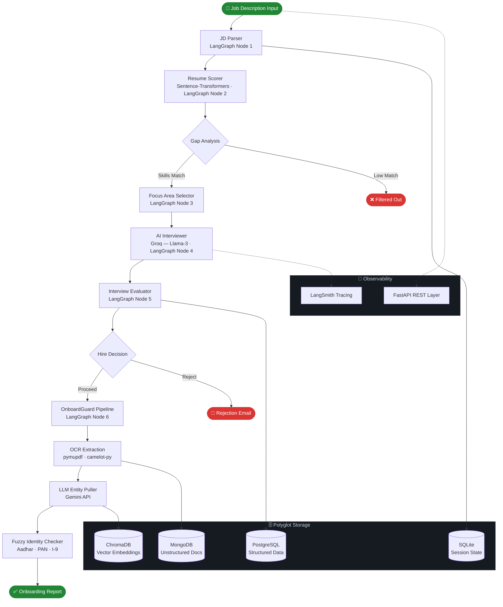
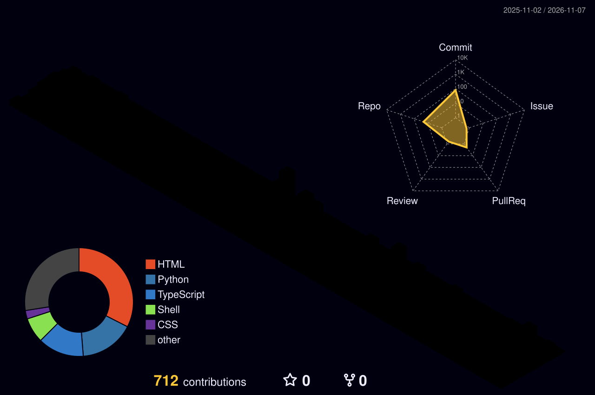

<div align="center">

<!-- Animated typing subtitle -->
<a href="https://github.com/bhatadarsh">
  
</a>

<br/>

<!-- Unified dark-palette navbar badges -->
<a href="https://www.linkedin.com/in/adarshbhavimane/">
  
</a>
<a href="mailto:bhatadarsh11@gmail.com">
  
</a>
<a href="https://github.com/bhatadarsh">
  
</a>
<a href="https://nex-assess.vercel.app">
  
</a>


</div>

---

<div align="center">

## `> whoami`

</div>

```yaml
Name        : Adarsh Bhavimane
Role        : DevOps Engineer  |  Cloud  |  Applied AI
Location    : Yellapur, Karnataka, India
Education   : B.E. Computer Science & Design — CGPA 8.3  (Alva's Institute of Engg. & Tech.)
Contact     : bhatadarsh11@gmail.com  ·  +91-8431630778

Experience:
  - DevOps Intern     @ Sigmoid Technologies  [ Jan 2026 – Jun 2026 ]
    → AI recruitment & onboarding platforms, Docker, API integrations, system reliability
  - Cloud & DevOps    @ MicroDegree           [ Sep 2025 – Dec 2025 ]
    → AWS (EC2, S3, IAM, VPC, CloudWatch), Docker deployments, CI/CD pipelines, Linux

Certifications:
  ✓ AWS Cloud Certification       — MicroDegree
  ✓ Cloud Computing  (80%)        — NPTEL
  ✓ Google AI Essentials           — Google
  ✓ DevOps Certification           — TuteDude
```

---

## 🛠 Tech Stack

<div align="center">

<table>
<tr>
<td align="center" width="100%">

**☁️ Cloud, DevOps & Infrastructure**


</td>
</tr>
<tr>
<td align="center">

**⚙️ Backend, Data & Databases**


</td>
</tr>
<tr>
<td align="center">

**🤖 Applied AI & LLM Stack** &nbsp;*(tools not in SkillIcons)*


</td>
</tr>
</table>

</div>

---

## 🏗 AI HirePro — Flagship System Architecture



---

## 🚀 Featured Projects

> Private projects are **fully documented below** (architecture + engineering decisions) so recruiters can evaluate technical depth without repo access.

### 🔒 Private Projects

<table>
<tr>
<td width="50%" valign="top">

<kbd>🔒 Private Architecture</kbd>

#### 🧠 AI HirePro Enterprise

> *Stateful LLM Recruitment Automation — LangGraph · Groq · FastAPI*

End-to-end recruitment pipeline where LangGraph agents handle everything from parsing to AI-conducted interviews to document onboarding.

- **LangGraph stateful graph** orchestrates 6 agents: JD parse → semantic scoring → gap analysis → focus-area selection → Groq interview → OnboardGuard verification
- **OnboardGuard**: OCR + Gemini entity extraction + fuzzy identity checks across Aadhar, PAN & I-9 — zero manual review
- **Polyglot DB fan-out**: SQLite + PostgreSQL + MongoDB + ChromaDB, all containerized via Docker Compose
- **LangSmith tracing** instruments every node for full pipeline observability
- **FastAPI REST layer** exposes all pipeline stages as async endpoints

`LangGraph` `LangChain` `Groq (Llama-3)` `Gemini API` `Sentence-Transformers`<br/>`FastAPI` `Docker Compose` `ChromaDB` `PostgreSQL` `MongoDB` `LangSmith`

</td>
<td width="50%" valign="top">

<kbd>🔒 Private Architecture</kbd> &nbsp; <kbd>🚀 <a href="https://nex-assess.vercel.app">Live Demo</a></kbd>

#### 🎯 NexAssess — Self-Hosted Assessment Platform

> *Production HackerRank Alternative — Next.js 15 · Prisma · Supabase*

Zero-cost, self-hosted alternative to HackerRank & Mettl — full ownership of your hiring pipeline.

- **AI proctoring**: real-time webcam + screen capture streams → risk scoring; tab-switch & focus-loss violations logged to audit trail
- **RBAC**: Admin / Recruiter / Candidate roles with JWT sessions + Vercel env secrets
- **507 automated tests**: Jest (unit + integration) + Playwright (E2E) on every GitHub Actions push — build fails fast
- **PWA + Vercel zero-downtime** rollouts backed by Supabase PostgreSQL

`Next.js 15` `TypeScript` `Prisma` `PostgreSQL` `Supabase`<br/>`GitHub Actions` `Playwright` `PWA` `Vercel`

</td>
</tr>
<tr>
<td width="50%" valign="top">

<kbd>🔒 Private Architecture</kbd>

#### 🏗️ Three-Tier EKS — Full IaC on AWS

> *Kubernetes + Terraform — Zero Manual Clicks*

Complete Infrastructure-as-Code for a three-tier web app on AWS EKS — `terraform apply` + `helm install` and you're done.

- **Terraform modules**: VPC (public/private subnets), EKS cluster, managed node groups, IAM least-privilege roles
- **Helm charts**: Frontend + Backend Deployments, Ingress, ConfigMaps, HPA
- **Dual auto-scaling**: AWS Cluster Autoscaler (nodes) + HPA (pods) working in tandem
- **Multi-arch builds**: `docker buildx --platform linux/amd64` → ECR → EKS

`Terraform` `AWS EKS` `Helm` `Kubernetes` `Docker` `ECR` `AWS ALB Controller`

</td>
<td width="50%" valign="top">

<kbd>🔒 Private Architecture</kbd>

#### 📊 SRE Monitoring Stack

> *Prometheus · Alertmanager · Jenkins — Observability-as-Code*

Production-grade alerting platform where every rule, route, and receiver is version-controlled code.

- **Prometheus** scrapes `node_exporter` + app metrics; custom `alert.rules.yml` with CPU/pod/service thresholds
- **Alertmanager inhibition rules** prevent alert storms during cascading failures
- **Jenkins pipeline** automates full stack deployment + config reload on every commit
- Mirrors real SRE alerting setups used in production environments

`Prometheus` `Alertmanager` `Grafana` `Jenkins` `YAML-as-Code`

</td>
</tr>
</table>

<br/>

### 🌐 Public Projects

<table>
<tr>
<td width="33%" valign="top">

<kbd>🌐 <a href="https://github.com/bhatadarsh/Automated-Pipeline-Debugger">Public Repo</a></kbd>

#### 🤖 Automated Pipeline Debugger

> *AI-Powered DevOps Automation*

Airflow failure events → Celery workers → OpenAI root-cause diagnosis → Slack delivers structured fix.

- Async FastAPI + PostgreSQL backend
- `tenacity` exponential-backoff on all LLM calls

`Python` `FastAPI` `Celery` `Redis` `OpenAI`<br/>`Apache Airflow` `Slack SDK` `PostgreSQL`

</td>
<td width="33%" valign="top">

<kbd>🌐 <a href="https://github.com/bhatadarsh/NL2SQL-Task">Public Repo</a></kbd>

#### 💬 AI Cloud Data Analyst

> *Natural Language → BigQuery → Insights*

Type a plain-English question → Gemini generates SQL → BigQuery runs it → auto-charts + AI narrative.

- Query safety guardrails prevent destructive SQL
- Interactive Streamlit dashboard

`Python` `Gemini LLM` `BigQuery` `Streamlit` `Pandas`

</td>
<td width="33%" valign="top">

<kbd>🌐 <a href="https://github.com/bhatadarsh/keyword-rank-tracker">Public Repo</a></kbd>

#### 📈 Keyword Rank Tracker

> *Full-Stack SERP Intelligence*

Automated Google rank tracker across countries, languages & devices — React frontend + FastAPI backend.

- SQLite (dev) / PostgreSQL (prod) dual-mode
- Full CI/CD via GitHub Actions

`TypeScript` `FastAPI` `React 18` `PostgreSQL` `SQLite`

</td>
</tr>
<tr>
<td width="33%" valign="top">

<kbd>🌐 <a href="https://github.com/bhatadarsh/elk-nginx-monitoring">Public Repo</a></kbd>

#### 🔍 ELK + Nginx Log Monitor

> *Production Log Observability Stack*

Nginx → Filebeat → Elasticsearch → Kibana. Fully Dockerized with live dashboards — mirrors real production observability.

`Docker Compose` `Elasticsearch` `Kibana` `Filebeat` `Nginx`

</td>
<td width="33%" valign="top">

<kbd>🌐 <a href="https://github.com/bhatadarsh/Vehicle-licence-detection">Public Repo</a></kbd>

#### 🚗 Vehicle Licence Detection

> *Computer Vision · OpenCV*

Real-time license plate detection + model trade-off analysis: Haar Cascade vs HOG+SVM vs YOLO — with justifications.

`Python` `OpenCV` `Haar Cascade` `CV`

</td>
<td width="33%" valign="top">

<kbd>🌐 <a href="https://github.com/bhatadarsh/FactFuse-A-Youtube-Transcript-Summarizer">Public Repo</a></kbd>

#### 🎬 FactFuse — YouTube Fact Scorer

> *NLP · Transcript Analysis*

Extracts YouTube transcripts → summarizes content → assigns factual-confidence score using NLP models.

`Python` `Flask` `YouTube Transcript API` `NLP`

</td>
</tr>
</table>

---

<details>
<summary><b>🔍 Recruiter Deep Dive — Private Project Architectures</b></summary>

<br/>

### AI HirePro — LangGraph Stateful Pipeline

**Problem:** Manual hiring is slow (each stage siloed), inconsistent (human bias), and unscalable.

**How it works (LangGraph stateful graph — 6 nodes):**
```
1. JD Parser            → structured skills/experience/context extraction
2. Resume Scorer        → sentence-transformers cosine similarity vs JD vector
3. Focus Area Selector  → dynamic interview topic selection from gap analysis
4. AI Interviewer       → Groq Llama-3 conducts structured interview, scores answers
5. Interview Evaluator  → aggregate scoring + hire/reject decision
6. OnboardGuard         → OCR → LLM entity pull → fuzzy match (Aadhar/PAN/I-9)
```
**Storage fan-out:** PostgreSQL (structured) · ChromaDB (vectors) · MongoDB (raw docs) · SQLite (session)
**Observability:** Every LangGraph node traced via LangSmith · FastAPI layer for external integrations

---

### NexAssess — Assessment Platform

**Architecture:** Next.js 15 App Router + Prisma ORM → Supabase PostgreSQL · Vercel edge deployment
**Proctoring:** WebRTC webcam/screen streams → event-driven risk scorer → admin CCTV dashboard
**Testing:** 507 tests (Jest unit + integration + Playwright E2E) in GitHub Actions CI pipeline
**Security:** JWT sessions, RBAC (3 roles), Vercel environment secrets, audit log on every candidate event

---

### Three-Tier EKS — Infrastructure as Code

```
terraform apply              # VPC + EKS + Node Groups + IAM
helm upgrade --install       # App Deployments + Services + Ingress + HPA
                             # AWS LB Controller + Cluster Autoscaler wired in
```
**Scaling:** HPA reacts to pod CPU → Cluster Autoscaler provisions new nodes automatically
**CI compatibility:** `docker buildx --platform linux/amd64` builds ensure ARM dev machines → x86 EKS consistency

---

### SRE Monitoring Stack — Alerting as Code

**Rules:** `alert.rules.yml` — CPU spikes, pod restarts, service-down — with `severity` labels
**Routing:** Alertmanager groups by `alertname` + `instance`, inhibits child alerts during parent outages
**Deployment:** Jenkins `Jenkinsfile` → `kubectl apply` → Prometheus config reload — zero manual steps

</details>

---

## 📊 GitHub Activity

<div align="center">


<br/>


&nbsp;

&nbsp;

&nbsp;


</div>

---

## 🌐 3D Contribution Calendar

<div align="center">

<!-- Generated daily by GitHub Actions (.github/workflows/profile-3d-contrib.yml) -->
<!-- After first workflow run, this will render as an interactive 3D isometric graph -->

<a href="https://github.com/bhatadarsh/bhatadarsh/actions/workflows/profile-3d-contrib.yml">
  <picture>
    <source media="(prefers-color-scheme: dark)" srcset="https://raw.githubusercontent.com/bhatadarsh/bhatadarsh/output/profile-3d-contrib/profile-night-rainbow.svg">
    <source media="(prefers-color-scheme: light)" srcset="https://raw.githubusercontent.com/bhatadarsh/bhatadarsh/output/profile-3d-contrib/profile-green-animate.svg">
    
  </picture>
</a>

<!-- Snake animation (also auto-generated by the same workflow) -->


</div>

---

## 🎓 Certifications

<div align="center">

| | Certification | Issuer | Skills Covered |
|:-:|---|---|---|
| ☁️ | AWS Cloud Certification | MicroDegree | EC2, S3, IAM, VPC, CloudWatch |
| 🧮 | Cloud Computing *(80%)* | NPTEL | Cloud Architecture Fundamentals |
| 🤖 | Google AI Essentials | Google | Applied AI, Gemini API, Prompt Engineering |
| ⚙️ | DevOps Certification | TuteDude | Docker, Kubernetes, CI/CD, Jenkins |

</div>

---

<div align="center">

**📬 Open to DevOps · Cloud · AI Engineering roles**

<a href="mailto:bhatadarsh11@gmail.com">
  
</a>
&nbsp;
<a href="https://www.linkedin.com/in/adarshbhavimane/">
  
</a>

<br/>

*"Ship infrastructure like code. Debug systems like a scientist. Automate like it's the last thing you'll ever do."*

<br/>


</div>
